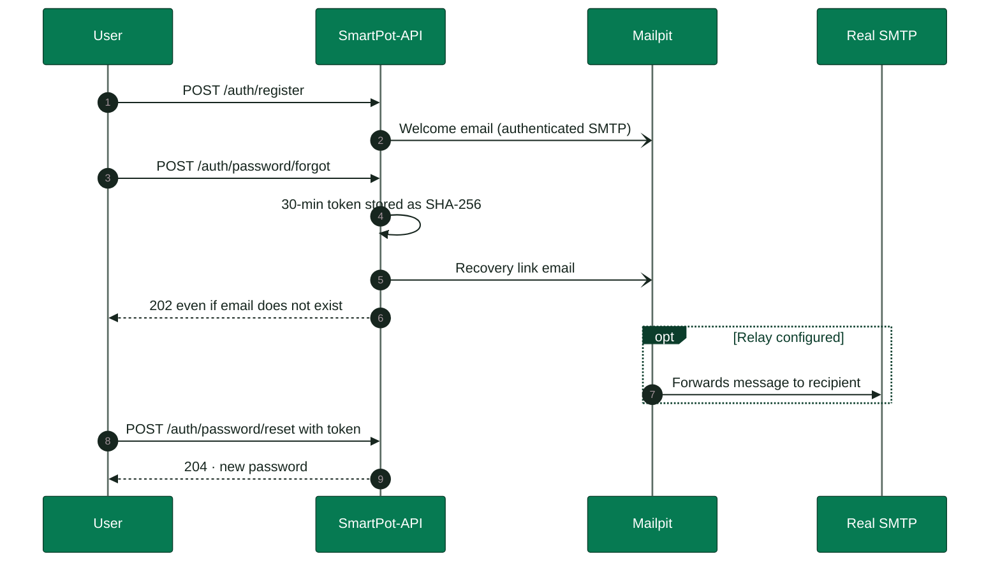

<!-- portada
eyebrow: Component Documentation · Documentación del componente
titulo: SmartPot-Mail
acento: Mail
subtitulo: SmartPot Mail Server · El correo de SmartPot
bajada: Mailpit with SMTP and web UI authentication for welcome and password recovery emails, with optional forwarding to a real SMTP provider. / Mailpit con autenticación SMTP y de interfaz para los correos de bienvenida y recuperación de contraseña, con reenvío opcional a un proveedor real.
documento: SmartPot-Mail
version: 1.0 · September 2026 / septiembre 2026
equipo: SmartPotTech
proyecto: smartpot.app
-->

# SmartPot-Mail

[English](#english) | [Español](#español)

---

# English

## Document Sheet

| Field                  | Value                                                                                                                                                                                                                                                                                                                                                                                                                                                   |
|------------------------|---------------------------------------------------------------------------------------------------------------------------------------------------------------------------------------------------------------------------------------------------------------------------------------------------------------------------------------------------------------------------------------------------------------------------------------------------------|
| Project                | SmartPot · [smartpot.app](https://smartpot.app)                                                                                                                                                                                                                                                                                                                                                                                                         |
| Component              | [SmartPot-Mail](https://github.com/SmartPotTech/SmartPot-Mail)                                                                                                                                                                                                                                                                                                                                                                                          |
| Version                | 1.0 · September 2026                                                                                                                                                                                                                                                                                                                                                                                                                                    |
| Scope                  | Platform emails, inbox protection, relay forwarding, configuration, and smoke tests                                                                                                                                                                                                                                                                                                                                                                     |
| Platform Documentation | [Technical Documentation](https://github.com/SmartPotTech/.github/blob/main/docs/SmartPot_Technical_Documentation.md), [Project Journey](https://github.com/SmartPotTech/.github/blob/main/docs/SmartPot_Project_Journey.md), [Software Lifecycle](https://github.com/SmartPotTech/.github/blob/main/docs/SmartPot_Software_Lifecycle.md), and [Global Diagrams](https://github.com/SmartPotTech/.github/blob/main/docs/README.md#diagramas-generales) |
| Maintenance            | Generated from `docs/` in this repository using `.github/docs/tools`; updated on every component change                                                                                                                                                                                                                                                                                                                                                 |

## 1. Purpose

### In Simple Terms

SmartPot sends two transactional emails: the welcome email upon account registration and the password recovery link. Mailpit receives them, retains them temporarily, and displays them in a protected web inbox; if an upstream SMTP provider is configured, it forwards them so they reach users' inboxes. Crop alerts do not go over email: they are delivered through the PWA and Telegram.

## 2. Component Architecture

```mermaid
%%{init: {"theme": "base", "fontFamily": "Segoe UI, Arial, sans-serif", "themeVariables": {"fontFamily": "Segoe UI, Arial, sans-serif", "fontSize": "15px", "primaryColor": "#DDF5EA", "primaryTextColor": "#17261F", "primaryBorderColor": "#067A52", "secondaryColor": "#E3F2FB", "secondaryTextColor": "#17261F", "secondaryBorderColor": "#1F6FA0", "tertiaryColor": "#F2F7F4", "tertiaryTextColor": "#17261F", "tertiaryBorderColor": "#D5E3DC", "lineColor": "#5B6B63", "textColor": "#17261F", "mainBkg": "#DDF5EA", "nodeBorder": "#067A52", "clusterBkg": "#F7FAF8", "clusterBorder": "#D5E3DC", "edgeLabelBackground": "#FFFFFF", "actorBkg": "#067A52", "actorBorder": "#0B3D2B", "actorTextColor": "#FFFFFF", "actorLineColor": "#5B6B63", "signalColor": "#17261F", "signalTextColor": "#17261F", "labelBoxBkgColor": "#0B3D2B", "labelBoxBorderColor": "#0B3D2B", "labelTextColor": "#FFFFFF", "loopTextColor": "#0B3D2B", "noteBkgColor": "#FDF4DD", "noteBorderColor": "#C98D12", "noteTextColor": "#17261F", "activationBkgColor": "#DDF5EA", "activationBorderColor": "#067A52", "attributeBackgroundColorOdd": "#FFFFFF", "attributeBackgroundColorEven": "#F2F7F4"}, "layout": "elk", "elk": {"nodePlacementStrategy": "BRANDES_KOEPF", "mergeEdges": false, "cycleBreakingStrategy": "GREEDY"}}}%%
flowchart LR
  api["SmartPot-API<br/>MailService"]
  admin(["SmartPot Team"])
  subgraph imagen["smartpot-mail image · Mailpit · user 1000"]
    direction TB
    smtp["SMTP :1025<br/>username & password<br/>internal network only"]
    ui["UI & API :8025<br/>dedicated username & password"]
    store[("Messages in /tmp<br/>30 days or 500 messages")]
  end
  nginx["nginx<br/>https://mail.smartpot.app"]
  relay["Optional real SMTP<br/>MP_SMTP_RELAY_*"]
  api -->|"welcome · recovery"| smtp --> store
  admin --> nginx --> ui --> store
  smtp -.->|"forwards if configured"| relay
  classDef leaf fill:#DDF5EA,stroke:#067A52,color:#17261F
  classDef water fill:#E3F2FB,stroke:#1F6FA0,color:#17261F
  classDef sun fill:#FDF4DD,stroke:#C98D12,color:#17261F
  classDef clay fill:#FBE9E1,stroke:#B85A38,color:#17261F
  classDef core fill:#067A52,stroke:#0B3D2B,color:#FFFFFF
  classDef deep fill:#0B3D2B,stroke:#06281C,color:#FFFFFF
  classDef muted fill:#F2F7F4,stroke:#5B6B63,color:#17261F
  class api,relay water
  class admin core
  class smtp,ui leaf
  class store muted
  class nginx sun
```

<!-- diagrama: SmartPot_Mail_Global_Component | titulo=SmartPot-Mail Inside · SmartPot-Mail por dentro -->

## 3. Mail Flow

<!-- diagrama: SmartPot_Mail_01_Mail_Flow | titulo=Welcome and Password Recovery · Bienvenida y recuperación de la contraseña -->

## 4. Security

| Control     | Detail                                                                                  |
|-------------|-----------------------------------------------------------------------------------------|
| SMTP        | Requires username and password; without TLS only because traffic stays on internal net  |
| Inbox       | `mail.smartpot.app` requires its own username and password                              |
| Credentials | Passed via environment variables; never written to files or logs                        |
| Container   | User `1000`, read-only filesystem; messages in `/tmp` with bounded retention            |

## 5. Configuration and Tests

| Variable                                     | Purpose                                              |
|----------------------------------------------|------------------------------------------------------|
| `MAIL_USERNAME`, `MAIL_PASSWORD`             | SMTP account used by the API                         |
| `MAILPIT_UI_USERNAME`, `MAILPIT_UI_PASSWORD` | Web inbox credentials                                |
| `MP_MAX_MESSAGES`, `MP_MAX_AGE`              | Maximum retained messages and age                    |
| `MP_SMTP_RELAY_*`                            | Optional forwarding to a real SMTP provider          |

`sh tests/smoke.sh smartpot-mail:ci` verifies that both SMTP and the web UI reject unauthenticated access, that an authenticated email is delivered, and that logs do not leak secrets. Every change on `main` runs through CI, publishes `ghcr.io/smartpottech/smartpot-mail`, and triggers the central `.github` deployment.

---

# Español

## Ficha del documento

| Campo                          | Valor                                                                                                                                                                                                                                                                                                                                                                                                                                                   |
|--------------------------------|---------------------------------------------------------------------------------------------------------------------------------------------------------------------------------------------------------------------------------------------------------------------------------------------------------------------------------------------------------------------------------------------------------------------------------------------------------|
| Proyecto                       | SmartPot · [smartpot.app](https://smartpot.app)                                                                                                                                                                                                                                                                                                                                                                                                         |
| Componente                     | [SmartPot-Mail](https://github.com/SmartPotTech/SmartPot-Mail)                                                                                                                                                                                                                                                                                                                                                                                          |
| Versión                        | 1.0 · septiembre 2026                                                                                                                                                                                                                                                                                                                                                                                                                                   |
| Alcance                        | Correos de la plataforma, protección de la bandeja, reenvío, configuración y pruebas                                                                                                                                                                                                                                                                                                                                                                    |
| Documentación de la plataforma | [Documentación técnica](https://github.com/SmartPotTech/.github/blob/main/docs/SmartPot_Technical_Documentation.md), [recorrido del proyecto](https://github.com/SmartPotTech/.github/blob/main/docs/SmartPot_Project_Journey.md), [ciclo de vida](https://github.com/SmartPotTech/.github/blob/main/docs/SmartPot_Software_Lifecycle.md) y [diagramas generales](https://github.com/SmartPotTech/.github/blob/main/docs/README.md#diagramas-generales) |
| Mantenimiento                  | Se genera desde `docs/` de este repositorio con las herramientas de `.github/docs/tools`; se actualiza con cada cambio del componente                                                                                                                                                                                                                                                                                                                   |

## 1. Propósito

### En palabras simples

SmartPot envía dos correos: la bienvenida al crear la cuenta y el enlace para recuperar la contraseña. Mailpit los recibe, los guarda un tiempo y los muestra en una bandeja protegida; si se configura un proveedor, los reenvía para que lleguen a las personas. Los avisos de los cultivos no van por correo: van por la PWA y por Telegram.

## 2. Arquitectura del componente

En la arquitectura del contenedor (`SmartPot_Mail_Global_Component`), `SmartPot-API` entrega los correos de bienvenida y recuperación en `:1025` (autenticado en red interna), el equipo consulta `:8025` tras Nginx con credenciales propias, y el almacén temporal en `/tmp` conserva hasta 500 mensajes o 30 días.

## 3. Flujo de los correos

En el flujo de secuencia (`SmartPot_Mail_01_Mail_Flow`), `POST /auth/register` dispara el correo de bienvenida y `POST /auth/password/forgot` genera un token de 30 minutos (guardado como SHA-256), envía el enlace por SMTP autenticado y responde `202` aunque el correo no exista.

## 4. Seguridad

| Control      | Detalle                                                                              |
|--------------|--------------------------------------------------------------------------------------|
| SMTP         | Exige usuario y contraseña; sin TLS solo porque el tráfico no sale de la red interna |
| Bandeja      | `mail.smartpot.app` exige su propio usuario y contraseña                             |
| Credenciales | Llegan por variables de entorno; no se escriben en archivos ni en los logs           |
| Contenedor   | Usuario `1000`, solo lectura; mensajes en `/tmp` con vida limitada                   |

## 5. Configuración y pruebas

| Variable                                     | Uso                                             |
|----------------------------------------------|-------------------------------------------------|
| `MAIL_USERNAME`, `MAIL_PASSWORD`             | Cuenta SMTP que usa la API                      |
| `MAILPIT_UI_USERNAME`, `MAILPIT_UI_PASSWORD` | Acceso a la bandeja                             |
| `MP_MAX_MESSAGES`, `MP_MAX_AGE`              | Cuántos mensajes y por cuánto tiempo se guardan |
| `MP_SMTP_RELAY_*`                            | Reenvío opcional a un proveedor real            |

`sh tests/smoke.sh smartpot-mail:ci` comprueba que el SMTP y la interfaz rechacen accesos sin credenciales, que un correo autenticado se entregue y que los logs no muestren secretos. Cada cambio en `main` pasa por el CI, publica `ghcr.io/smartpottech/smartpot-mail` y pide el despliegue central de `.github`.
