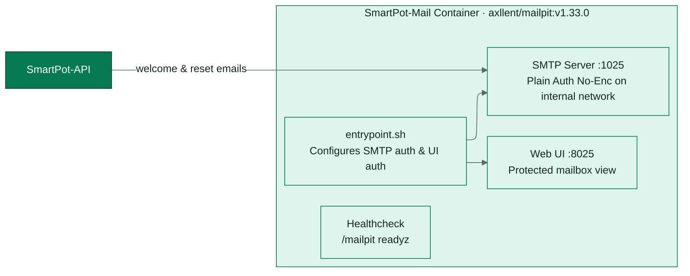

<!-- portada
eyebrow: Component Technical Documentation
titulo: SmartPot-Mail
acento: Mail
subtitulo: Dedicated Notification & Mail Services
bajada: Mailpit v1.33.0 deployment with authenticated SMTP and Web UI for transactional notifications, welcome sequences, and password recovery workflows, supporting optional upstream SMTP relay.
documento: SmartPot-Mail Documentation
version: 1.0 · September 2026
equipo: SmartPotTech
proyecto: smartpot.app
-->

# SmartPot-Mail

---

## Document Sheet

| Field                  | Value                                                                                                                                                                                                                                                                                                                                                                                                                                                   |
|------------------------|---------------------------------------------------------------------------------------------------------------------------------------------------------------------------------------------------------------------------------------------------------------------------------------------------------------------------------------------------------------------------------------------------------------------------------------------------------|
| Project                | SmartPot · [smartpot.app](https://smartpot.app)                                                                                                                                                                                                                                                                                                                                                                                                         |
| Component              | [SmartPot-Mail](https://github.com/SmartPotTech/SmartPot-Mail)                                                                                                                                                                                                                                                                                                                                                                                          |
| Version                | 1.0 · September 2026                                                                                                                                                                                                                                                                                                                                                                                                                                    |
| Scope                  | Platform emails, inbox protection, relay forwarding, configuration, and smoke tests                                                                                                                                                                                                                                                                                                                                                                     |
| Platform Documentation | [Technical Documentation](https://github.com/SmartPotTech/.github/blob/main/docs/SmartPot_Technical_Documentation.md), [Project Journey](https://github.com/SmartPotTech/.github/blob/main/docs/SmartPot_Project_Journey.md), [Software Lifecycle](https://github.com/SmartPotTech/.github/blob/main/docs/SmartPot_Software_Lifecycle.md), and [Global Diagrams](https://github.com/SmartPotTech/.github/blob/main/docs/README.md#diagramas-generales) |
| Maintenance            | Generated from `docs/` in this repository using `.github/docs/tools`; updated on every component change                                                                                                                                                                                                                                                                                                                                                 |

## 1. Purpose

### In Simple Terms

SmartPot sends two transactional emails: the welcome email upon account registration and the password recovery link. Mailpit v1.33.0 receives them, retains them temporarily, and displays them in a protected web inbox; if an upstream SMTP provider is configured, it forwards them so they reach users' inboxes. Crop alerts do not go over email: they are delivered through the PWA and Telegram.

## 2. Component Architecture

<!-- diagrama: SmartPot_Mail_Global_Component | titulo=SmartPot-Mail Inside · SmartPot-Mail por dentro -->

## 3. Mail Flow

```mermaid
%%{init: {"theme": "base", "fontFamily": "Segoe UI, Arial, sans-serif", "themeVariables": {"fontFamily": "Segoe UI, Arial, sans-serif", "fontSize": "15px", "primaryColor": "#DDF5EA", "primaryTextColor": "#17261F", "primaryBorderColor": "#067A52", "secondaryColor": "#E3F2FB", "secondaryTextColor": "#17261F", "secondaryBorderColor": "#1F6FA0", "tertiaryColor": "#F2F7F4", "tertiaryTextColor": "#17261F", "tertiaryBorderColor": "#D5E3DC", "lineColor": "#5B6B63", "textColor": "#17261F", "mainBkg": "#DDF5EA", "nodeBorder": "#067A52", "clusterBkg": "#F7FAF8", "clusterBorder": "#D5E3DC", "edgeLabelBackground": "#FFFFFF", "actorBkg": "#067A52", "actorBorder": "#0B3D2B", "actorTextColor": "#FFFFFF", "actorLineColor": "#5B6B63", "signalColor": "#17261F", "signalTextColor": "#17261F", "labelBoxBkgColor": "#0B3D2B", "labelBoxBorderColor": "#0B3D2B", "labelTextColor": "#FFFFFF", "loopTextColor": "#0B3D2B", "noteBkgColor": "#FDF4DD", "noteBorderColor": "#C98D12", "noteTextColor": "#17261F", "activationBkgColor": "#DDF5EA", "activationBorderColor": "#067A52", "attributeBackgroundColorOdd": "#FFFFFF", "attributeBackgroundColorEven": "#F2F7F4"}}}%%
flowchart LR
  api["SmartPot-API<br/>internal/mail"] -->|"SMTP :1025 (authenticated)"| mailpit["SmartPot-Mail (Mailpit v1.33.0)"]
  mailpit -->|"Web UI :8025 (Basic Auth)"| admin["Admin / Developer Mailbox"]
  classDef core fill:#067A52,stroke:#0B3D2B,color:#FFFFFF
  classDef leaf fill:#DDF5EA,stroke:#067A52,color:#17261F
  class api,admin core
  class mailpit leaf
```

<!-- diagrama: SmartPot_Mail_01_Mail_Flow | titulo=Welcome and Password Recovery · Bienvenida y recuperación de la contraseña -->

## 4. Security

| Control     | Detail                                                                                  |
|-------------|-----------------------------------------------------------------------------------------|
| SMTP        | Requires username and password; without TLS only because traffic stays on internal net  |
| Inbox       | `mail.smartpot.app` requires its own username and password                              |
| Credentials | Passed via environment variables; never written to files or logs                        |
| Container   | User `1000`, read-only filesystem; messages in `/tmp` with bounded retention            |

## 5. Configuration and Tests

| Variable                                     | Purpose                                              |
|----------------------------------------------|------------------------------------------------------|
| `MAIL_USERNAME`, `MAIL_PASSWORD`             | SMTP account used by the API                         |
| `MAILPIT_UI_USERNAME`, `MAILPIT_UI_PASSWORD` | Web inbox credentials                                |
| `MP_MAX_MESSAGES`, `MP_MAX_AGE`              | Maximum retained messages and age                    |
| `MP_SMTP_RELAY_*`                            | Optional forwarding to a real SMTP provider          |

`sh tests/smoke.sh smartpot-mail:ci` verifies that both SMTP and the web UI reject unauthenticated access, that an authenticated email is delivered, and that logs do not leak secrets. Every change on `main` runs through CI, publishes `ghcr.io/smartpottech/smartpot-mail`, and triggers the central `.github` deployment.

---
