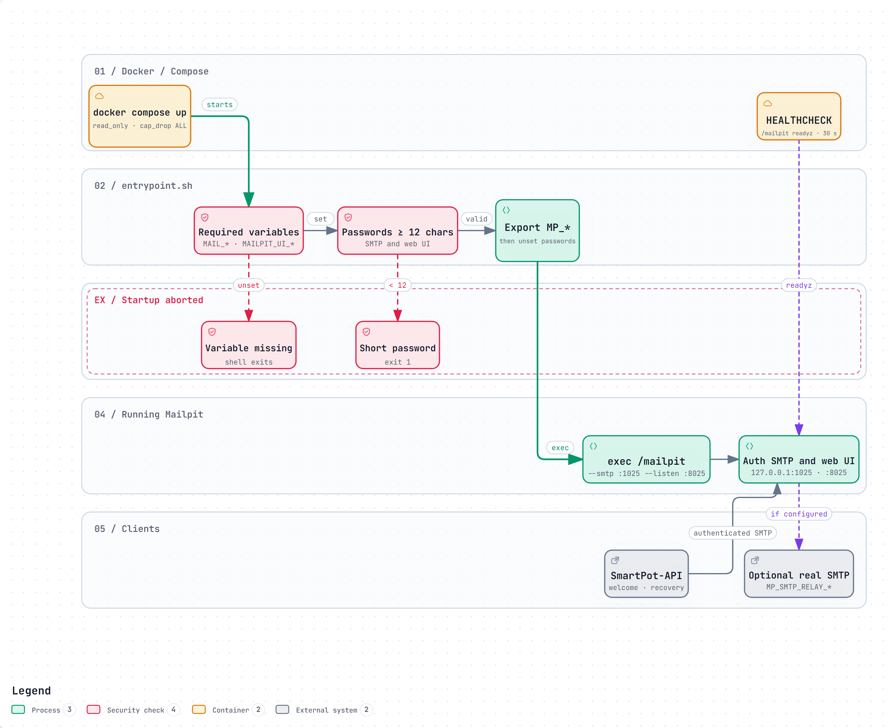
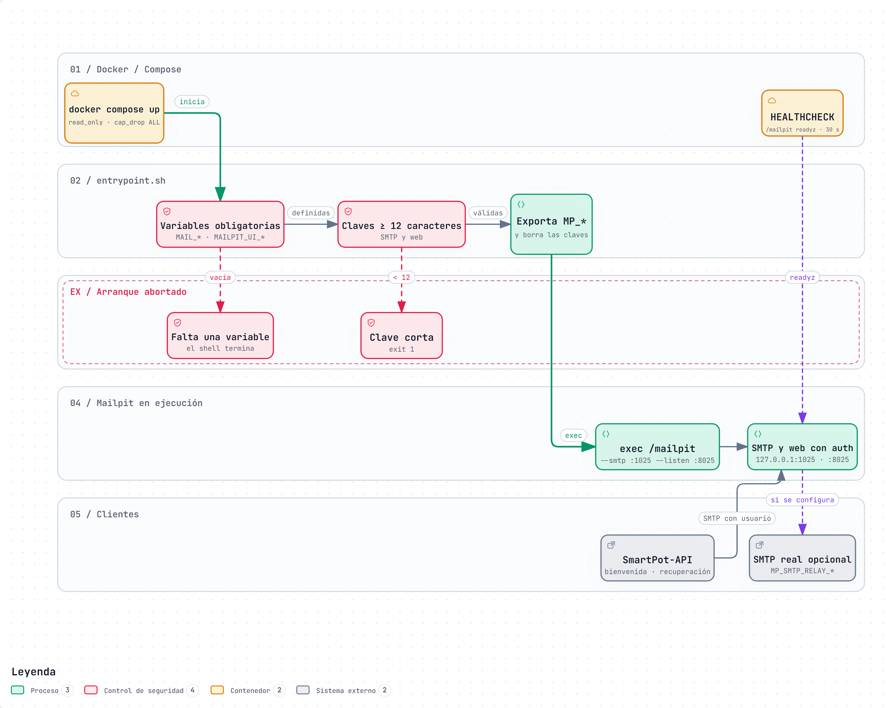

# SmartPot-Mail · Interactive Diagrams

[English](#english) | [Español](#español)

---

## English

Each diagram is a self-contained HTML page that works offline. Download it and open it in a browser to zoom, search nodes, trace a path and jump to the exact source lines on GitHub. The PNG preview is the light-theme render of the same diagram.

### 1. Hardened Startup

How `entrypoint.sh` refuses to start Mailpit without the four credentials or with passwords shorter than 12 characters, hands the credentials over only as `MP_SMTP_AUTH` and `MP_UI_AUTH`, unsets the plain passwords and then `exec`s Mailpit inside a read-only container with every capability dropped. It also shows the `readyz` healthcheck, the authenticated SMTP traffic from SmartPot-API and the optional relay to a real SMTP provider.

- Interactive: [English](SmartPot_Mail_A1_Startup_Workflow.en.html) · [Spanish](SmartPot_Mail_A1_Startup_Workflow.es.html)
- Sources: `entrypoint.sh`, `compose.yaml`, `Dockerfile`, `.env.example` and `README.md` at commit `9e1a539`.

---

## Español

Cada diagrama es una página HTML autocontenida que funciona sin conexión. Descárgala y ábrela en un navegador para ampliar, buscar nodos, seguir un recorrido y saltar a las líneas exactas del código en GitHub. La vista previa PNG es el mismo diagrama en tema claro.

### 1. Arranque endurecido

Cómo `entrypoint.sh` se niega a arrancar Mailpit si falta alguna de las cuatro credenciales o si una contraseña tiene menos de 12 caracteres, entrega las credenciales solo como `MP_SMTP_AUTH` y `MP_UI_AUTH`, borra las contraseñas en claro y hace `exec` de Mailpit dentro de un contenedor de solo lectura sin capacidades. También muestra el healthcheck `readyz`, el SMTP autenticado que llega desde SmartPot-API y el reenvío opcional a un SMTP real.

- Interactivo: [inglés](SmartPot_Mail_A1_Startup_Workflow.en.html) · [español](SmartPot_Mail_A1_Startup_Workflow.es.html)
- Fuentes: `entrypoint.sh`, `compose.yaml`, `Dockerfile`, `.env.example` y `README.md` en el commit `9e1a539`.

